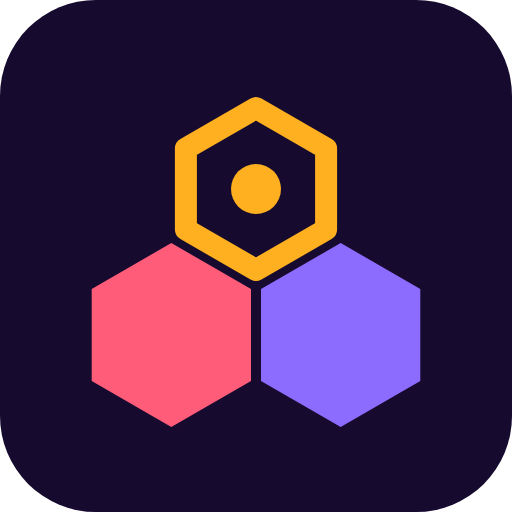

  

<h1 align="center">Colony Labs</h1>

  Security research on games and their launchers

  <a href="#members">Members</a> ·
  <a href="#how-we-work">How we work</a> ·
  <a href="#repositories">Repositories</a> ·
  <a href="#current-work">Current work</a> ·
  <a href="#contact">Contact</a>

---

## Members

Colony Labs is a two-person group. Reports are signed with OpenPGP, and each key is published on the member's GitHub profile.

| | Member | Key fingerprint |
|:---:|---|---|
|  | [**whyKusanagi**](https://github.com/whykusanagi) | `9404 90EF 09DA 3132 2BF7 FD83 8758 49AB 1D54 1C55` ([key](https://github.com/whykusanagi.gpg)) |
|  | [**MotherSphere**](https://github.com/MotherSphere) Author of the [NIKKE PC launcher incident write-up](https://gist.github.com/MotherSphere/d6c049a09ba8ac3085c51ee9df24a4e5) and of [NIKKE Launcher Check](https://github.com/MotherSphere/NIKKE-Launcher-Check) | `AE58 84DC 6943 0793 D228 9764 FCA0 D446 9593 62B0` ([key](https://github.com/MotherSphere.gpg)) |

## How we work

| Stage | Rule |
|---|---|
| **Testing** | Only software we installed ourselves, on our own machines or on disposable virtual machines and CI runners. We never touch other people's accounts or data, and we never load-test a vendor's servers. |
| **Reporting** | The vendor's security contact hears first, with a disclosure date agreed in advance. When players are at risk right away, the national CERTs get a copy the same day. |
| **Publishing** | Once the fix has shipped and we have checked it, or once the agreed date has passed. |
| **Content** | An advisory has the smallest proof the vendor needs to reproduce the flaw. No working exploits and no personal data. |

## Repositories

| Repository | Contents | Visibility |
|---|---|---|
| `advisories` | One folder per finding, from the first draft to publication, and our disclosure policy | Private. Each advisory becomes public on its disclosure date. |
| `research` | Working notes and analysis scripts | Private |
| `lab` | Workflows that install and observe software on throwaway CI runners | Private |

## Current work

> [!IMPORTANT]
> The findings below are under coordinated disclosure. Their details stay private until publication.

| Product | Vendor | Reported | Coordinators | Advisories | Disclosure |
|---|---|---|---|:---:|---|
| NIKKE PC launcher for Windows | Level Infinite / Proxima Beta | 2026-11-08, addendum 2026-11-10 | SingCERT, KrCERT/CC, JPCERT/CC, CISA | 10 | 2026-12-08, or earlier for findings fixed and verified before then |

Players who want to check their PC can use [NIKKE Launcher Check](https://github.com/MotherSphere/NIKKE-Launcher-Check) and read the [incident write-up](https://gist.github.com/MotherSphere/d6c049a09ba8ac3085c51ee9df24a4e5).

## Contact

To report a vulnerability or ask about an advisory, write to **mothersphere.colony@gmail.com** or **me@whykusanagi.xyz**. Encrypt to the keys above if the content is sensitive.
